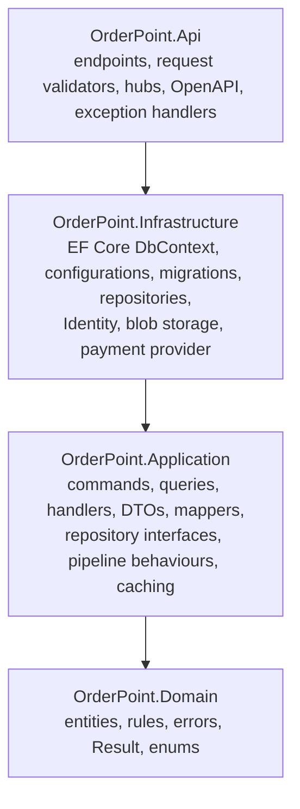
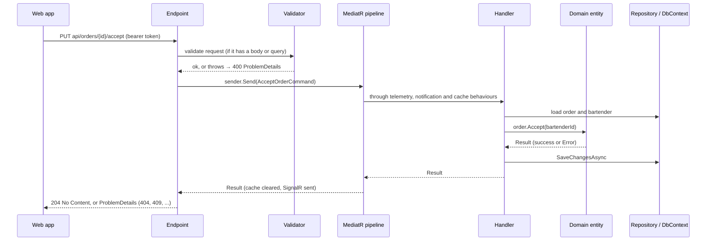

# Backend architecture

> **Planned change.** This page describes the API as it is today: one application in four layers. It is about to become a modular monolith (Staff, Catalog, Floor, Inventory, Ordering, Reporting); see the [Roadmap](Roadmap) and [`docs/modular-monolith-plan.md`](https://github.com/mucnjakf/OrderPoint/blob/main/docs/modular-monolith-plan.md). This page will follow each phase.

The API is an ASP.NET Core Minimal API on .NET 10, built in clean-architecture layers with CQRS through MediatR. Business rules live in the domain entities, use cases in command and query handlers, and the endpoints only translate HTTP.

## Layers



| Layer | Holds | Knows about |
| --- | --- | --- |
| **Domain** | Entities with private setters, `Create`/`Update` methods that enforce the rules, domain errors, the `Result` type, enums and sort options | Nothing |
| **Application** | One file per use case (the command or query and its handler), DTOs and their mappers, repository and service interfaces, MediatR pipeline behaviours, cache keys and tags, telemetry | Domain |
| **Infrastructure** | `ApplicationDbContext` (also the unit of work), one EF configuration per entity, migrations, repositories, ASP.NET Core Identity's user store, token service, blob storage, the simulated payment provider | Application, Domain |
| **Api** | One endpoint per file with its request record and FluentValidation validator, SignalR hubs and notifiers, exception handlers, OpenAPI transformers, health | Everything |

Types are as private as possible: entities and DTOs are public because other layers use them, while handlers, repositories and most services are `internal`.

## A request, end to end



## Domain

- **Entities** are `sealed`, inherit `Entity` (`Id`, `CreatedAtUtc`, `UpdatedAtUtc`), have private setters and a private constructor. Ids are `Guid.CreateVersion7()` (time-ordered), times are `DateTimeOffset` in UTC.
- **Creation and changes** go through methods that check the rules and return a result instead of throwing: `static Result<T> Create(...)`, `Result Update(...)`, and behaviour methods such as `Order.Accept(bartenderId)` or `StockItem.RecordWaste(amount, note)`.
- **Errors** are static fields in `Errors/<Entity>Errors.cs`, each with a code like `Order.InvalidStatusTransition` and a type (Validation, NotFound, Conflict, Unauthorized, Forbidden, Failure) that becomes the HTTP status. See [Error codes](Error-Codes).
- **Child collections** are private lists exposed read-only.

See [Domain model](Domain-Model) for every entity.

## Application: CQRS with MediatR

Each use case is one file holding the message and its handler, for example `Commands/Orders/CancelOrderCommand.cs`:

```csharp
public sealed record CancelOrderCommand(Guid Id)
    : ICommand, ICacheInvalidatingCommand, IOrderNotifyingCommand
{
    IReadOnlyList<string> ICacheInvalidatingCommand.InvalidatedCacheTags => CacheTags.OrderChanges;
}

internal sealed partial class CancelOrderCommandHandler(
    IOrderRepository orderRepository,
    IUnitOfWork unitOfWork,
    ChangedOrders changedOrders,
    ILogger<CancelOrderCommandHandler> logger)
    : ICommandHandler<CancelOrderCommand>
{
    public async Task<Result> Handle(CancelOrderCommand command, CancellationToken cancellationToken)
    {
        Order? order = await orderRepository.GetAsync(command.Id, cancellationToken);

        if (order is null)
        {
            return Result.Failure(OrderErrors.NotFound);
        }

        Result result = order.Cancel();

        if (result.IsFailure)
        {
            return Result.Failure(result.Error);
        }

        await unitOfWork.SaveChangesAsync(cancellationToken);

        changedOrders.Add(order.Id);

        LogOrderCancelled(order.Number);

        return Result.Success();
    }
}
```

- **Messages:** `ICommand`, `ICommand<T>` and `IQuery<T>` are the project's own interfaces over MediatR. Handlers return `Result` or `Result<T>` and never throw for business failures.
- **Typical command flow:** load → not found → check related data → call the domain method → save through `IUnitOfWork` → return.
- **Uniqueness** (a bartender's email, a category's name) is checked in the handler with `ExistsBy...Async` before saving, backed by a unique index.
- **Bulk commands** (status, delete, category, price) are all-or-nothing: every id must exist and every blocker is checked for the whole set before anything is saved.
- **Reads** return DTOs built by hand-written mappers (`ToXDto()`); paged lists return `PaginationDto<T>`. Most reads are cached; see [Caching](Caching).

### Pipeline behaviours

Every command and query passes through these behaviours, outermost first:

| Behaviour | Does |
| --- | --- |
| `TelemetryBehavior` | A trace span, a duration metric and one log line per request, with the error code on failure |
| `OrderNotificationBehavior` | After a successful order-changing command, tells the apps (`OrdersChanged`, and `OrderChanged` to the guests following those orders) |
| `MenuNotificationBehavior` | After a menu change, or when stock made items sell out or come back, sends `MenuChanged` |
| `TablesNotificationBehavior` | After a floor plan or table request change, sends `TablesChanged` |
| `CacheInvalidationBehavior` | After a successful command, clears the cache tags it declares |

Because the cache is cleared inside the notification behaviours, an app that reloads on a notification never reads stale data.

## Infrastructure

- **EF Core with Npgsql:** `ApplicationDbContext` implements `IUnitOfWork`; one `IEntityTypeConfiguration<T>` per entity sets table names, lengths, precision (money 10,2), indexes and relationships. Foreign keys are `Restrict`, so a parent with children can't be deleted by accident; the handler checks first and returns a clear conflict. The only database-generated value is the order number.
- **Repositories** (`<Entity>EfCoreRepository`) build paged queries from small `Search`, `Filter` and `Sort` helpers; reads use `AsNoTracking`, loads for commands stay tracked. Counts for a page come from one grouped query.
- **Migrations** are applied automatically when the API starts. See [Database and migrations](Database-and-Migrations).
- **Identity:** ASP.NET Core Identity's user store only (password hashing, lockout, unique email), saved together with everything else by the handler's unit of work. Tokens are issued by a small token service. See [Security](Security).
- **Storage:** `IImageStorage` uploads to `<folder>/<guid>` in the `images` container and deletes old pictures after the change is saved.
- **Payments:** `IPaymentProvider` is implemented by a simulated provider.
- **Dashboard:** `IDashboardRepository` is the one read-model exception: it returns DTOs straight from aggregations over orders and stock movements.

## API layer

- **One endpoint per file** (`Endpoints/<Feature>/<Action><Entity>Endpoint.cs`), discovered automatically. The request record and its validator sit in the same file.
- **Flow:** validate → build the command or query → `sender.Send` → `TypedResults` on success, or `result.ToProblemDetails()`.
- **Responses** wrap data as `{ "data": ... }`. Create returns 201 with a link to the resource, update and delete return 204.
- **Authorization:** every endpoint names its policy (Admin, Bartender, AdminOrBartender), or is deliberately anonymous; see [Roles and permissions](Roles-and-Permissions).
- **Errors:** domain errors become ProblemDetails with an `errors` array. Exception handlers turn validation failures and malformed requests into 400, and anything unexpected into a logged 500 without details.
- **Documentation:** OpenAPI with Scalar at `/scalar`; every endpoint has a summary, a Markdown description listing its errors, and documented request and response records. See [API reference](API-Reference).

## Cross-cutting

- **Caching:** HybridCache (memory + Redis), tags per feature; see [Caching](Caching).
- **Real time:** SignalR hubs and notifiers; see [Real-time updates](Real-Time-Updates).
- **Observability:** OpenTelemetry traces, metrics and logs; see [Observability](Observability).
- **Business day:** the configured start hour (06:00) defines "today" for the dashboard, My shift and the register.