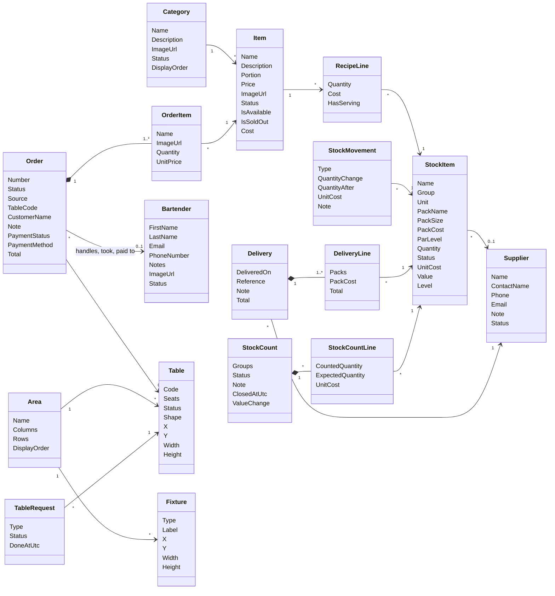

# Domain model

The business rules live in the entities of `OrderPoint.Domain`. This page describes each entity: what it represents, what it can do and which rules it enforces. The tables and columns behind them are on [ER diagram](ER-Diagram); the error codes and their HTTP statuses on [Error codes](Error-Codes).

## How entities are built

- Every entity is `sealed` and inherits `Entity`, which gives it `Id` (a time-ordered GUID), `CreatedAtUtc` and `UpdatedAtUtc`.
- Properties have private setters and the constructor is private, so an entity can only be created and changed through its methods.
- **Creating:** `static Result<T> Create(...)` checks the rules and returns either the entity or an error. Nothing throws for a business rule.
- **Changing:** `Result Update(...)` and behaviour methods (`Accept`, `RecordWaste`, `Close`, ...) check their rules, apply the change and set `UpdatedAtUtc`.
- **Children:** child collections are private lists exposed read-only (`IReadOnlyList<T>`); children are created through their parent.
- **What the entity can't check** (uniqueness, existence of other records, blockers such as "a category with items") is checked by the command handler before calling the entity, and backed by unique indexes and restrictive foreign keys.

## Menu

### Category

A group of items on the menu, such as Cocktails or Beer.

- **Has:** name, description, picture, status, display order (its position in the menu).
- **Can:** `Create`, `Update`, `ChangeStatus`, `ChangeDisplayOrder`, `SetImage`, `RemoveImage`.
- **Rules:**
  - Name and description are required.
  - A new category goes to the end of the menu.
  - Reordering must list every category exactly once.
  - A category with items can't be deleted.
  - Deactivating a category never changes its items' own statuses, but makes them unavailable.
- **Errors:** `Category.NotFound`, `NameIsRequired`, `DescriptionIsRequired`, `ImageUrlIsRequired`, `DisplayOrderMustIncludeAllCategories`, `CannotDeleteCategoryWithItems`.

### Item

Something guests can order, such as a Mojito.

- **Has:** category, name, description, portion, price, picture, status, its recipe lines.
- **Can:** `Create`, `Update`, `ChangePrice`, `ChangeCategory`, `ChangeStatus`, `SetImage`, `RemoveImage`, `CreateRecipe`.
- **Derived:**
  - **`IsSoldOut`:** an ingredient of its recipe has less than one serving left.
  - **`IsAvailable`:** the item and its category are active and it isn't sold out. Only available items can be ordered.
  - **`Cost`:** the sum of its recipe lines at their stock items' unit cost, or none without a recipe.
- **Rules:**
  - Name and description are required.
  - Portion and price must be positive.
  - A recipe's quantities must be positive and each stock item may appear once.
  - An item that appears on orders can't be deleted.
  - Deleting an item deletes its recipe.
- **Errors:** `Item.NotFound`, `NameIsRequired`, `DescriptionIsRequired`, `PortionMustBePositive`, `PriceMustBePositive`, `ImageUrlIsRequired`, `RecipeQuantityMustBePositive`, `RecipeHasDuplicateStockItems`, `CannotDeleteItemWithOrders`.

## Orders

### Order

One order with its lines and its payment. The full state machine is on [Order lifecycle](Order-Lifecycle).

- **Has:** a number (#128, generated by the database), status, source, table (and the table code it was placed with), customer name (counter orders), note, the bartender who handles it, the bartender who entered it, the status times, the decline reason, and the payment: status, method, paid and refunded times, who took it, cash received.
- **Creating:**
  - `Create` for a guest: an active table is required.
  - `CreateByBartender`: a table, or none for a counter order with an optional name.
  - `CreateAtRegister`: always at the counter.

  All three refuse an empty order, quantities below 1 and unavailable items. Each line copies the item's name, picture and price.
- **Status:** `Accept`, `Activate`, `Complete`, `Decline`, `DeclineByAdmin`, `Cancel`, `Withdraw`, `Release`.
- **Payment:** `PayByCard`, `PayAtRegister`, `CompleteRefund`. Declining, cancelling and withdrawing refund a paid order themselves: at once for a guest's online card, as a refund due for money the register took.
- **Derived:** `Total`, the sum of the lines.
- **Errors:**
  - `Order.NotFound`, `ItemsAreRequired`, `QuantityMustBePositive`, `ItemIsUnavailable`, `InvalidStatusTransition`, `DeclineReasonIsRequired`, `AssignedToAnotherBartender`, `EnteredByAnotherBartender`.
  - Payments: `Payment.CardDeclined`, `AlreadyPaid`, `NotEnoughCash`, `NothingToPay`, `NoRefundDue`.

### OrderItem

A line of an order: the item, its name, picture and unit price when ordered, and the quantity. Each item appears once per order. Lines are never changed after the order is placed.

## Staff

### Bartender

A member of the bar staff. Their login (an Identity user with role Bartender) has the same id.

- **Has:** first and last name, email (also the login), phone number, notes, picture, status.
- **Can:** `Create`, `Update`, `ChangeStatus`, `SetImage`, `RemoveImage`.
- **Rules:**
  - First name, last name and email are required, and the email is unique.
  - Deactivating revokes the bartender's sessions and releases their accepted and active orders back to the queue.
  - A bartender who handled or entered orders, or took payments, can't be deleted.
- **Errors:** `Bartender.NotFound`, `FirstNameIsRequired`, `LastNameIsRequired`, `EmailIsRequired`, `ImageUrlIsRequired`, `EmailAlreadyExists`, `CannotDeleteBartenderWithOrders`; sign-in errors are under `Auth.*` (see [Security](Security)).

## Floor

### Area

A part of the floor plan with a grid of cells.

- **Has:** a unique name, a size in columns and rows, a display order (tab order).
- **Can:** `Create`, `Update`.
- **Rules:**
  - The name is required and the grid size positive.
  - The grid can't shrink below its tables and fixtures.
  - An area with tables can't be deleted; its fixtures are deleted with it.
- **Errors:** `Area.NotFound`, `NameIsRequired`, `GridSizeMustBePositive`, `TooSmallForContents`, `NameAlreadyExists`, `CannotDeleteAreaWithTables`.

### Table

- **Has:** area, a unique code (in its QR code), seats, status, shape, position and size in cells.
- **Can:** `Create`, `Update`, `Place` (move, also to another area, or resize).
- **Rules:**
  - The code is required and seats are positive.
  - It must lie inside its area. Overlaps are left to the editor, which refuses them.
  - Guests and bartenders can't order to an inactive table.
  - A table with orders can't be deleted. Deleting one deletes its requests.
- **Errors:** `Table.NotFound`, `CodeIsRequired`, `SeatsMustBePositive`, `OutsideArea`, `IsInactive`, `CodeAlreadyExists`, `CannotDeleteTableWithOrders`.

### Fixture

A bar counter, entrance or wall on the plan, with an optional label.

- **Can:** `Create`, `Update`, `Place`.
- **Rules:** it must lie inside its area.
- **Errors:** `Fixture.NotFound`, `OutsideArea`.

### TableRequest

A guest's call for a bartender.

- **Has:** table, type (Call bartender), status (Open or Done), when it was done.
- **Can:** `Create`, `Complete`.
- **Rules:** a table has at most one open request of a type; asking again returns it. Who answered is not stored.
- **Errors:** `TableRequest.NotFound`, `AlreadyDone`.

## Inventory

How these work together is explained on [Inventory](Inventory).

### StockItem

Something the bar buys and uses.

- **Has:** unique name, group, base unit, pack name and size, pack cost, par level, quantity, status, supplier.
- **Derived:**
  - **`UnitCost`:** pack cost ÷ pack size.
  - **`Value`:** quantity × unit cost, never negative.
  - **`Level`:** Out at ≤ 0, Low at or below par, otherwise Ok.
- **Can:**
  - `Create`, `Update`, `RemoveSupplier`.
  - Quantity changes, each of which returns a new `StockMovement`: `RecordOpening`, `RecordWaste`, `Correct`, `RecordSale`, and (used by deliveries and counts) `RecordDelivery` and `RecordCount`.
- **Rules:**
  - Name and pack name are required, pack size is positive, pack cost and par are not negative.
  - The unit can't change after creation.
  - Waste and sales must be positive; a correction can't be negative or unchanged.
  - A sale may take the quantity below zero, because served drinks are never refused.
  - A delivery averages the pack cost with the stock on the shelf.
  - It can't be deleted once it has movements other than its opening, a recipe uses it, or a count includes it.
- **Errors:** `StockItem.NotFound`, `NameIsRequired`, `PackNameIsRequired`, `PackSizeMustBePositive`, `PackCostMustNotBeNegative`, `ParLevelMustNotBeNegative`, `QuantityMustBePositive`, `QuantityMustNotBeNegative`, `QuantityUnchanged`, `NameAlreadyExists`, `UsedInRecipes`, `UsedInCounts`, `CannotDeleteWithMovements`.

### StockMovement

One change to a stock item's quantity: type, signed change, the quantity after it, the unit cost at that moment and a note. Created only by `StockItem`'s methods and never edited, so the history can always be valued at the cost of its time.

### RecipeLine

What one serving of an item takes from a stock item, in the stock item's base unit. Unique per item and stock item.

- **Derived:** `Cost` (quantity × unit cost) and `HasServing` (the stock item holds at least one serving).

### Supplier

- **Has:** unique name, contact name, phone, email, note, status.
- **Can:** `Create`, `Update`.
- **Rules:** the name is required. A supplier with deliveries can't be deleted; deleting one without deliveries takes it off its stock items.
- **Errors:** `Supplier.NotFound`, `NameIsRequired`, `NameAlreadyExists`, `CannotDeleteWithDeliveries`.

### Delivery and DeliveryLine

Goods received from a supplier on a date, with an optional invoice number and note, and lines of packs at a price per pack.

- **Can:** `Create` (with its lines), and `RecordStock`, which adds every line to its stock item as a Delivery movement valued at the delivery's own price.
- **Derived:** `Total`, the sum of packs × price.
- **Rules:**
  - At least one line, each stock item once.
  - Packs must be positive and prices not negative.
  - Never edited or deleted.
- **Errors:** `Delivery.NotFound`, `LinesAreRequired`, `PacksMustBePositive`, `PackCostMustNotBeNegative`, `HasDuplicateStockItems`.

### StockCount and StockCountLine

A count of the chosen stock groups, with one line per active stock item of those groups.

- **Can:**
  - `Create` for some groups.
  - `Count(lineId, quantity)`: enters a figure, or clears it with none. Entering a figure also takes the expected quantity and unit cost at that moment.
  - `Close(note)`: turns every counted line with a difference into a Count movement.
- **Derived:** `ValueChange`, the counted lines' difference in euros.
- **Rules:**
  - At least one group, and at least one stock item in them.
  - Only one count is open at a time.
  - Figures can't be negative.
  - Only an open count can be counted or closed, and closing needs at least one figure.
  - Discarding an open count deletes its lines.
- **Errors:** `StockCount.NotFound`, `LineNotFound`, `GroupsAreRequired`, `QuantityMustNotBeNegative`, `AlreadyOpen`, `NoStockItems`, `NotOpen`, `NothingCounted`.

## Shared types

| Type | Purpose |
| --- | --- |
| `Result`, `Result<T>` | Success, or failure with an `Error`; returned by entities and handlers instead of throwing |
| `Error` | A code (`Entity.Reason`), a description and a type: Validation, NotFound, Conflict, Unauthorized, Forbidden, Failure (and RequestValidation for the API's own validation) |
| Enums | Statuses, sources, units, groups and types; values on [ER diagram](ER-Diagram#enum-values) |
| Sort options | One enum per list (`ItemSortBy`, `OrderSortBy`, ...) with the allowed sort orders |