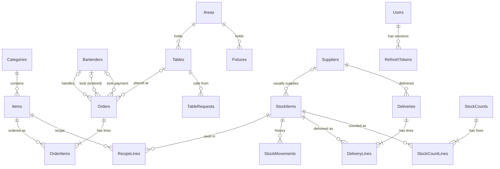
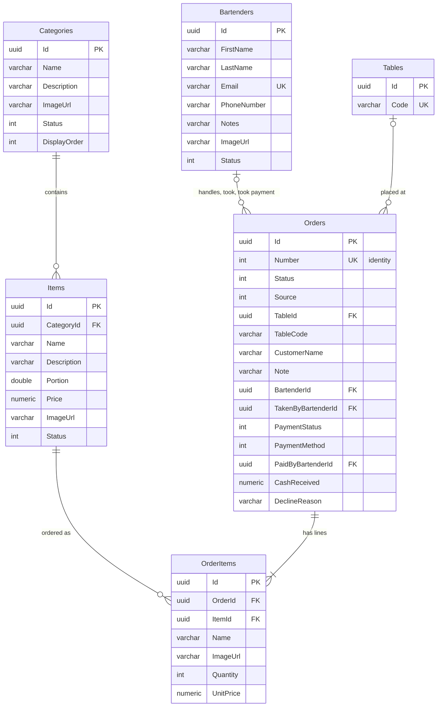
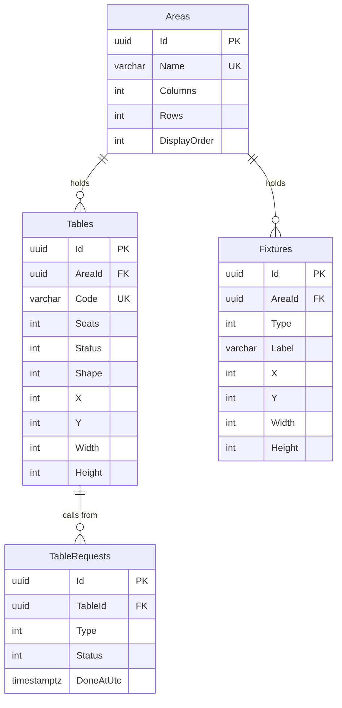
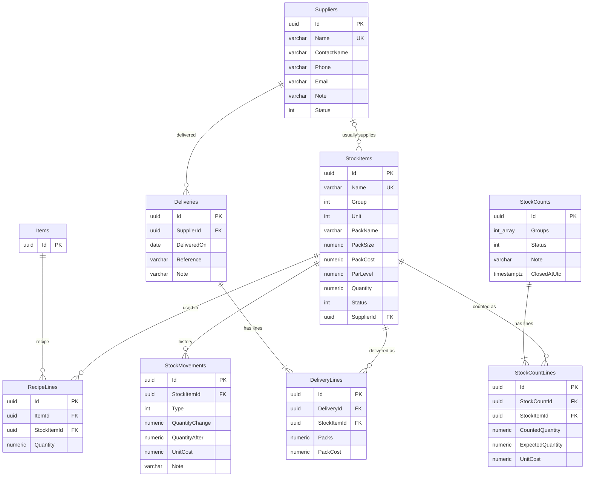
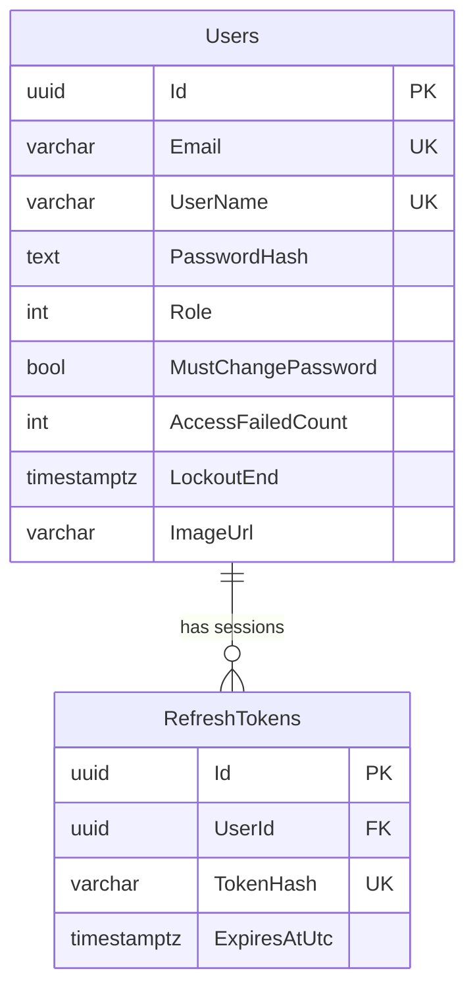

# ER diagram

The database is PostgreSQL (`order-point-db`), one schema (`public`), 19 tables created by EF Core migrations (plus EF's `__EFMigrationsHistory`). This page shows how the tables relate and lists every column. What the entities mean and which rules they enforce is on [Domain model](Domain-Model).

**Conventions used by every table:**

- **`Id`** is a `uuid` primary key generated by the application (`Guid.CreateVersion7()`, time-ordered).
- **`CreatedAtUtc`** and **`UpdatedAtUtc`** are `timestamp with time zone`, stored in UTC; `UpdatedAtUtc` is null until the first change. (`Users` and `RefreshTokens` come from Identity and differ slightly.)
- **Enums** are stored as `integer`; their values are listed at the end of this page.
- **Money** is `numeric(10,2)`, stock quantities `numeric(12,3)`, unit costs `numeric(12,6)`.
- **Foreign keys** are `ON DELETE RESTRICT`: the application checks first and refuses with a clear error (e.g. a category with items). The one exception is `StockCountLines`, which cascade with their count.

## Overview

`Users` and `Bartenders` are linked by sharing the same `Id` (a bartender's login has the bartender's id); there is no foreign key between them, because the admin's user has no bartender.

## Menu and orders

## Floor plan

## Inventory

## Accounts

## Tables and columns

Every table also has `Id`, `CreatedAtUtc` and `UpdatedAtUtc` (see the conventions above), not repeated below. "Required" means `NOT NULL` for text columns; numbers, enums and ids without a `?` are always required.

### Categories

A menu category.

| Column | Type | Notes |
| --- | --- | --- |
| Name | varchar(30), required | |
| Description | varchar(100), required | Shown under the name in the customer app |
| ImageUrl | varchar(200) | Full URL of the picture in Blob Storage |
| Status | integer | `CategoryStatus` |
| DisplayOrder | integer | Position in the menu; gaps are allowed |

### Items

A menu item.

| Column | Type | Notes |
| --- | --- | --- |
| CategoryId | uuid → Categories | Index |
| Name | varchar(30), required | |
| Description | varchar(200), required | |
| Portion | double precision | E.g. 0.3 (litres) or 1 (piece) |
| Price | numeric(10,2) | Euros |
| ImageUrl | varchar(200) | |
| Status | integer | `ItemStatus` (the item's own status) |

### Orders

An order from a guest, a bartender or the register, with its payment.

| Column | Type | Notes |
| --- | --- | --- |
| Number | integer | `GENERATED ALWAYS AS IDENTITY`, unique: the human-readable #128 |
| Status | integer | `OrderStatus` |
| Source | integer | `OrderSource` |
| TableId | uuid? → Tables | Index; null for counter orders |
| TableCode | varchar(10) | The code the table had when the order was placed |
| CustomerName | varchar(30) | Counter orders only: whom to call |
| Note | varchar(200) | For the bartender |
| BartenderId | uuid? → Bartenders | Index; who handles it (set on accept, or on decline from pending) |
| TakenByBartenderId | uuid? → Bartenders | Index; who entered it (Bartender app and register) |
| AcceptedAtUtc, ActivatedAtUtc, CompletedAtUtc, DeclinedAtUtc, CancelledAtUtc | timestamptz? | When each status was reached |
| DeclineReason | varchar(200) | Shown to the guest |
| PaymentStatus | integer | `PaymentStatus` |
| PaymentMethod | integer? | `PaymentMethod`, null while unpaid |
| PaidAtUtc, RefundedAtUtc | timestamptz? | |
| PaidByBartenderId | uuid? → Bartenders | Index; null for a guest's online card payment |
| CashReceived | numeric(10,2)? | For the change on the receipt |

The total is not stored; it is the sum of the lines.

### OrderItems

One line of an order. It copies the item's name, picture and price, so menu changes never rewrite past orders.

| Column | Type | Notes |
| --- | --- | --- |
| OrderId | uuid → Orders | Unique together with ItemId (each item once per order) |
| ItemId | uuid → Items | Index |
| Name | varchar(30), required | The item's name when ordered |
| ImageUrl | varchar(200) | The item's picture when ordered |
| Quantity | integer | 1 to 20 for guests |
| UnitPrice | numeric(10,2) | The item's price when ordered |

### Bartenders

| Column | Type | Notes |
| --- | --- | --- |
| FirstName, LastName | varchar(30), required | |
| Email | varchar(100), required | Unique; also the login's email |
| PhoneNumber | varchar(20) | |
| Notes | varchar(500) | For the owner |
| ImageUrl | varchar(200) | |
| Status | integer | `BartenderStatus` |

### Areas

| Column | Type | Notes |
| --- | --- | --- |
| Name | varchar(30), required | Unique |
| Columns, Rows | integer | Size of the grid in cells |
| DisplayOrder | integer | Order of the area tabs |

### Tables

| Column | Type | Notes |
| --- | --- | --- |
| AreaId | uuid → Areas | Index |
| Code | varchar(10), required | Unique; capital letters, digits and hyphens; in the QR code |
| Seats | integer | |
| Status | integer | `TableStatus` |
| Shape | integer | `TableShape` |
| X, Y, Width, Height | integer | Position and size in grid cells |

### Fixtures

| Column | Type | Notes |
| --- | --- | --- |
| AreaId | uuid → Areas | Index |
| Type | integer | `FixtureType` |
| Label | varchar(30) | Optional text on the plan |
| X, Y, Width, Height | integer | Position and size in grid cells |

### TableRequests

A guest's call for a bartender.

| Column | Type | Notes |
| --- | --- | --- |
| TableId | uuid → Tables | Index |
| Type | integer | `TableRequestType` |
| Status | integer | `TableRequestStatus` |
| DoneAtUtc | timestamptz? | When a bartender marked it done |

### StockItems

| Column | Type | Notes |
| --- | --- | --- |
| Name | varchar(100), required | Unique |
| Group | integer | `StockGroup` |
| Unit | integer | `StockUnit`, fixed after creation |
| PackName | varchar(30), required | "bottle", "keg", ... |
| PackSize | numeric(12,3) | Base units per pack |
| PackCost | numeric(10,2) | Euros per pack (average after deliveries) |
| ParLevel | numeric(12,3) | Base units |
| Quantity | numeric(12,3) | Base units on the shelf; may be negative |
| Status | integer | `StockItemStatus` |
| SupplierId | uuid? → Suppliers | Index |

### StockMovements

Every change to a stock item's quantity, never edited.

| Column | Type | Notes |
| --- | --- | --- |
| StockItemId | uuid → StockItems | Index |
| Type | integer | `StockMovementType` |
| QuantityChange | numeric(12,3) | Signed, base units |
| QuantityAfter | numeric(12,3) | The quantity after this movement |
| UnitCost | numeric(12,6) | Euros per base unit at that moment |
| Note | varchar(200) | E.g. "Order #128", "Spilled" |

### RecipeLines

| Column | Type | Notes |
| --- | --- | --- |
| ItemId | uuid → Items | Unique together with StockItemId |
| StockItemId | uuid → StockItems | Index |
| Quantity | numeric(12,3) | Base units per serving |

### Suppliers

| Column | Type | Notes |
| --- | --- | --- |
| Name | varchar(100), required | Unique |
| ContactName | varchar(100) | |
| Phone | varchar(30) | |
| Email | varchar(100) | |
| Note | varchar(200) | |
| Status | integer | `SupplierStatus` |

### Deliveries

| Column | Type | Notes |
| --- | --- | --- |
| SupplierId | uuid → Suppliers | Index |
| DeliveredOn | date | The day the goods came |
| Reference | varchar(50) | Invoice number |
| Note | varchar(200) | |

### DeliveryLines

| Column | Type | Notes |
| --- | --- | --- |
| DeliveryId | uuid → Deliveries | Unique together with StockItemId |
| StockItemId | uuid → StockItems | Index |
| Packs | numeric(12,3) | |
| PackCost | numeric(10,2) | Price per pack on this delivery |

### StockCounts

| Column | Type | Notes |
| --- | --- | --- |
| Groups | integer[] | The `StockGroup`s counted (a Postgres array) |
| Status | integer | `StockCountStatus` |
| Note | varchar(200) | |
| ClosedAtUtc | timestamptz? | |

### StockCountLines

| Column | Type | Notes |
| --- | --- | --- |
| StockCountId | uuid → StockCounts | `ON DELETE CASCADE`; unique together with StockItemId |
| StockItemId | uuid → StockItems | Index |
| CountedQuantity | numeric(12,3)? | Null until counted |
| ExpectedQuantity | numeric(12,3)? | The system's quantity when the figure was entered |
| UnitCost | numeric(12,6)? | The unit cost when the figure was entered |

### Users

ASP.NET Core Identity's user, trimmed to what OrderPoint uses.

| Column | Type | Notes |
| --- | --- | --- |
| Email, UserName | varchar(100), required | Normalized copies have unique indexes |
| PasswordHash | text, required | Identity's hash |
| SecurityStamp, ConcurrencyStamp | text, required | Identity's stamps |
| Role | integer | `UserRole` |
| MustChangePassword | boolean | Set for a new or reset bartender login |
| AccessFailedCount, LockoutEnabled, LockoutEnd | integer, boolean, timestamptz? | Lockout after 5 failures |
| ImageUrl | varchar(200) | The admin's profile picture |

### RefreshTokens

| Column | Type | Notes |
| --- | --- | --- |
| UserId | uuid → Users | Index |
| TokenHash | varchar(64), required | SHA-256 of the token, unique; the token itself is never stored |
| ExpiresAtUtc | timestamptz | 7 days after it was issued |

## Enum values

| Enum | Values (stored integer) |
| --- | --- |
| `OrderStatus` | Pending 0, Accepted 1, Declined 2, Active 3, Completed 4, Cancelled 5 |
| `OrderSource` | Guest 0, Bartender 1, Register 2 |
| `PaymentStatus` | Unpaid 0, Paid 1, RefundDue 2, Refunded 3 |
| `PaymentMethod` | Cash 0, Card 1 |
| `CategoryStatus`, `ItemStatus`, `BartenderStatus`, `TableStatus`, `StockItemStatus`, `SupplierStatus` | Active 0, Inactive 1 |
| `TableShape` | Rectangle 0, Round 1 |
| `FixtureType` | BarCounter 0, Entrance 1, Wall 2 |
| `TableRequestType` | CallBartender 0 |
| `TableRequestStatus` | Open 0, Done 1 |
| `StockGroup` | Spirits 0, Beer 1, Wine 2, Mixers 3, Syrups 4, Garnish 5, Other 6 |
| `StockUnit` | Milliliter 0, Gram 1, Piece 2 |
| `StockMovementType` | Opening 0, Waste 1, Correction 2, Sale 3, Delivery 4, Count 5 |
| `StockCountStatus` | Open 0, Closed 1 |
| `UserRole` | Admin 0, Bartender 1 |