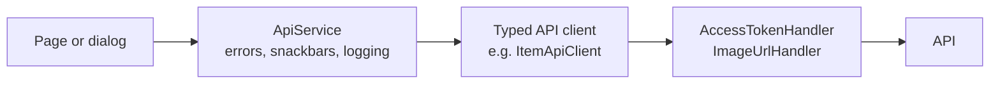

# Frontend architecture

All five apps are **Blazor Web Apps with the Interactive Server render mode** and **MudBlazor 9**. The UI runs on the app's server and the browser stays connected to it over a SignalR circuit; the app's server, not the browser, calls the API. Code the apps share lives in a Razor class library, `OrderPoint.Shared`.

## Why Blazor Server

- One language (C#) and one set of DTOs and rules on both sides of the UI.
- The API is only ever called server to server: tokens never sit in browser JavaScript, and the API needs no CORS.
- Live updates are natural: the app's server receives a SignalR message from the API and re-renders the circuit.
- The trade-off is a permanent connection per open tab; a lost connection shows a themed "Reconnecting" dialog.

See [Architecture decisions](Architecture-Decisions).

## Projects

| Project | Role |
| --- | --- |
| `OrderPoint.Shared` | Razor class library: auth, account, API error handling, shared components, shared DTOs (orders, menu, tables), theme, live connection service, image proxy, formatting helpers |
| `OrderPoint.Admin` | Owner's desktop app |
| `OrderPoint.Bar` | Bar staff, phone and tablet |
| `OrderPoint.Bartender` | Floor staff, phone and tablet |
| `OrderPoint.Register` | The till, desktop |
| `OrderPoint.Customer` | Guests, phone, anonymous |

The apps reference `OrderPoint.Shared` and never each other. They don't reference the API projects either: each keeps its own copies of the DTOs and enums it needs, so the HTTP contract is the only coupling.

## Structure of an app

Every app is organised by **feature folder**, the same way:

```
Items/
  Api/            ItemApiClient, Requests/, Responses/
  Components/     ItemCard.razor + ItemCard.razor.cs, ItemCardSkeleton...
  Dialogs/        CreateItemDialog, UpdateItemDialog, DeleteItemDialog...
  Dtos/           ItemDto...
  Enumerations/
  Pages/          ItemsPage.razor + ItemsPage.razor.cs
  Sorting/        ItemSortBy, ItemSorting (labels and icons)
Shared/
  Components/  Constants/  Extensions/  Layout/  Pages/
```

- **Markup and code are always split:** `X.razor` holds only markup, `X.razor.cs` the `public sealed partial class X`. No `@code` blocks.
- **Pages and dialogs:** in the Admin, create, edit, delete and details are MudBlazor dialogs opened from the list page. In the phone apps (Bar, Bartender, Customer), anything beyond a confirmation is its own page with a back arrow.

## Calling the API



- **Typed API clients** (`internal sealed class ItemApiClient(HttpClient httpClient)`) build relative URLs, escape user text, throw an `ApiException` for error responses and unwrap the `{ data }` envelope.
- **`ApiService`** is the only way pages call them. It owns error handling: a failed query returns `null` after showing an error snackbar, and a mutation returns `true` or `false` and shows the success or error snackbar. Pages never show API errors themselves. Unexpected exceptions are logged; expected API errors and cancellations are not.
- **`AccessTokenHandler`** attaches the signed-in user's token to every call. Because HttpClient handlers live outside the Blazor circuit's DI scope, it reaches the circuit's `AuthService` through a circuit services accessor.
- **`ImageUrlHandler`** rewrites the stored image URLs in responses to the app's own `/images/...` path, which streams them from Blob Storage (so phones see pictures through the tunnel).

## Sign-in and session

- **`AuthService`** (one per circuit) keeps the access and refresh tokens in protected browser storage, refreshes the access token a minute before it expires (parallel calls share one refresh), and raises `SessionChanged`.
- **`MainLayout` is the gate:** it renders nothing until the session is loaded, then either the page or the shared `LoginForm`. No page needs an `[Authorize]` attribute.
- **`LoginForm`** is shared and takes the app's role and name; it also handles a bartender's first sign-in, when they must choose a password.
- **When a refresh fails**, calls throw a session-expired exception that `ApiService` ignores, and the login form says the session expired.
- **Prerendering is off,** because browser storage can only be read once the circuit is connected.
- The customer app has no sign-in. It keeps its state (the table, the cart, the guest's orders) in protected browser storage for one visit.

## Live updates

`OrdersHubService` (shared, one per circuit) connects to the API's `hubs/orders` with the SignalR .NET client, retries after 0, 2, 10 and then every 30 seconds, and raises `OrdersChanged`, `MenuChanged` and `TablesChanged`. After a reconnect it raises all three, since messages sent while it was down are lost. Pages subscribe when they initialise, unsubscribe when disposed, and **reload silently**: no skeleton, selection kept. The customer app does the same with its own tracking hub. See [Real-time updates](Real-Time-Updates).

## Pages: loading, empty and live states

- **Sections load independently and in parallel.** Each section has its own loading flag and load method that ends with `StateHasChanged()`, so it appears as soon as its data arrives.
- **Skeletons** mirror the real layout of each section (`ItemCardSkeleton` next to `ItemCard`); the spinner is only a fallback.
- **Lists keep their height** while loading or paging (`StableHeight`), so the pager never jumps; a pager change scrolls back to the top.
- **Numbers that change live** roll up or down (`RollingNumber`), and new orders fade in with a "New" chip.
- **The Admin's list components** each give a feature its own shape: `DataTable` (categories), `DataGrid` (items, suppliers), `DataAccordion` (bartenders), `DataTimeline` (orders), `DataSheet` (stock, deliveries, count sheet), `DataLedger` (payments, counts) and `DataList` (lists inside dialogs). All share search, sort, filters, paging and bulk actions.

## Look and feel

- **Theme:** a monochrome theme ("vercel" from tweakcn) with dark and light palettes, the Geist font, 8 px radius, no shadows (surfaces get a thin border instead) and buttons in sentence case. Dark mode is the default and is remembered per browser; the customer app can follow the phone.
- **MudBlazor first:** components and Material icons, colours only from the theme palette, almost no custom CSS (a few scoped styles in the shared library).
- **Formatting follows the browser:** each request switches to the browser's culture for numbers, dates and the 12 or 24-hour clock, with English month and day names and amounts always in euros. Times are stored in UTC and shown in the browser's time zone, read once per circuit.
- **Pictures everywhere:** every bartender, item and category name comes with its picture or initials, with soft corners and a placeholder when missing.
- **Lost connection:** a themed reconnect dialog replaces Blazor's default.

## Shared library highlights

| Area | Contents |
| --- | --- |
| `Auth/`, `Account/` | `AuthService`, `LoginForm`, `AccountService`, password and sign-out dialogs |
| `Services/` | `ApiService`, `TimeZoneService`, `DarkModeService` |
| `Orders/` | Order DTOs and enums, `OrdersHubService`, `NewOrdersTracker`, `OrderAvatar`, the printable `Receipt` |
| `Menu/` | The guests' menu DTOs and client, menu category and item rows |
| `Items/` | `ItemCardContent` and `ItemCardImage` used by several apps |
| `Tables/` | Floor plan DTOs and the `FloorPlanMap` component (with drag and drop in the Admin) |
| `Components/` | `StatefulView`, `RollingNumber`, `ListPager`, `StableHeight`, `LiveIndicator`, `QuantityStepper`, `StatusMessage`, ... |
| `Layout/` | `AppTheme`, `ReconnectModal` |
| `Images/` | The `/images` proxy |
| `Extensions/` | Formatting helpers for money, dates, statuses, payments and places |