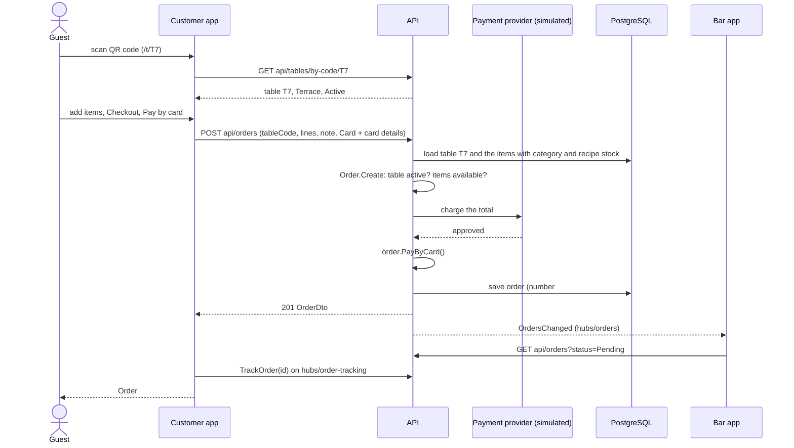
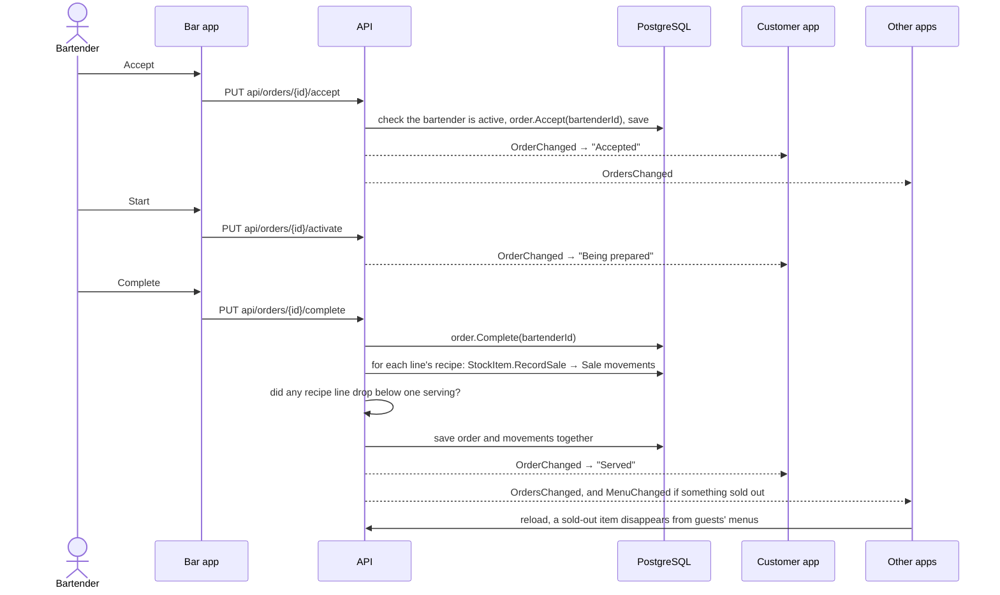
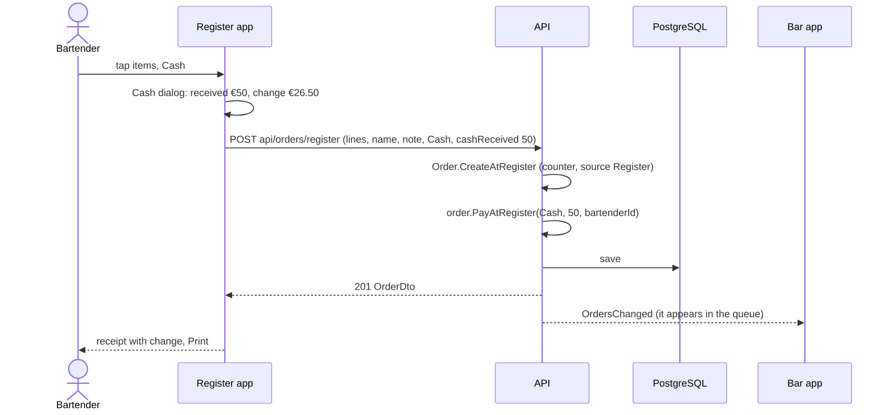
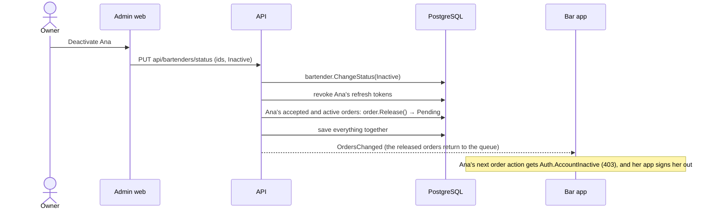
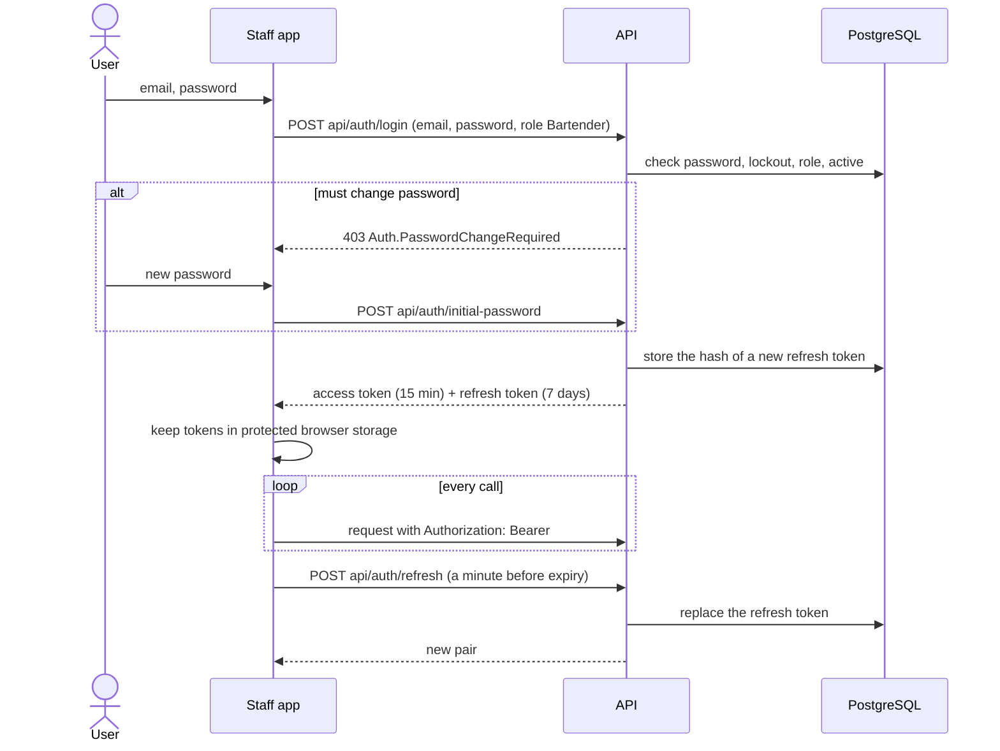

# Key flows

Sequence diagrams of the scenarios that cross the most parts of the system. "App" means the app's server, which calls the API; the browser only talks to its app (see [Frontend architecture](Frontend-Architecture)).

## A guest orders and pays by card

A declined card returns `Payment.CardDeclined` and nothing is saved. An item that became unavailable returns `Order.ItemIsUnavailable`; the customer app reloads the menu and marks the line.

## The bar prepares and serves it

If another bartender accepted the order first, Accept returns `Order.InvalidStatusTransition` (409) and the Bar app shows why and reloads.

## A counter sale at the register, paid in cash

Orders from the tables are paid later the same way with `PUT api/orders/{id}/pay` from the To pay list.

## A bartender is deactivated

## Signing in and staying signed in

When the refresh fails (expired, revoked by "sign out everywhere"), the app shows the login form with "Your session expired".