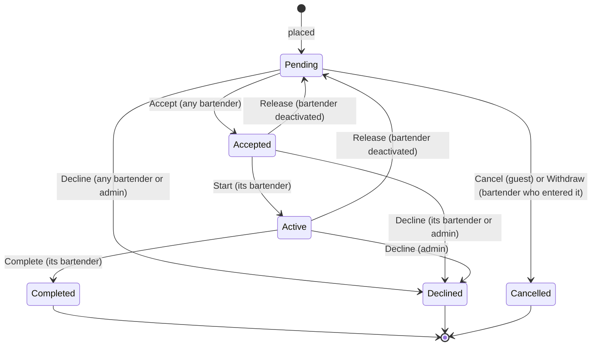
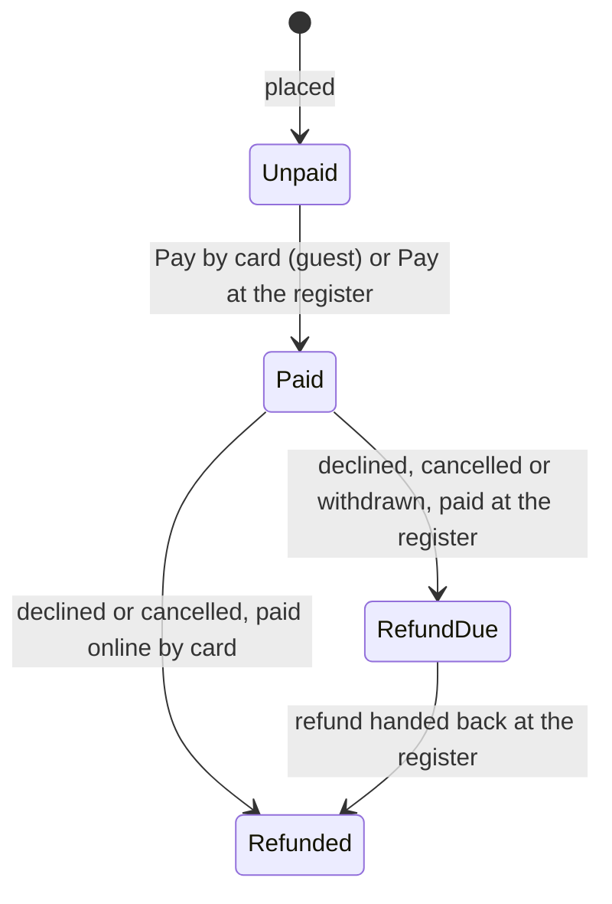

# Order lifecycle

An order has two independent states: its **status** (where it is at the bar) and its **payment status** (whether it is paid). Both change only through the rules on the `Order` entity, so every app follows the same rules.

## Where orders come from

| Source | Placed by | Place | Paid |
| --- | --- | --- | --- |
| **Guest** | A guest in the customer app | Their table | By card at once, or in cash at the register later |
| **Bartender** | A bartender in the Bartender app | A table or the counter | At the register later |
| **Register** | A bartender at the register | The counter | At once, cash or card |

A counter order has no table; it may carry a name to call ("Counter · Ana"). Every order gets a sequential **number** (#128) from the database, and its lines copy the item's name, picture and price at the moment it is placed, so later menu changes never rewrite past orders.

Placing an order is refused when an item is unavailable (inactive, in an inactive category, or sold out) or when the table is unknown or closed. A guest's order has at most 50 lines, each item once, 1 to 20 of each.

## Status

| Transition | Who | Rule | Records |
| --- | --- | --- | --- |
| **Accept** | Any bartender | Only a pending order; claims it for this bartender | `BartenderId`, `AcceptedAtUtc` |
| **Start** (activate) | The bartender who accepted it | Only an accepted order | `ActivatedAtUtc` |
| **Complete** | Its bartender | Only an active order; takes the recipes' ingredients off the stock | `CompletedAtUtc` |
| **Decline** | A bartender | A pending order (they become its bartender) or their own accepted order; a reason is required (up to 200 characters) | `DeclinedAtUtc`, `DeclineReason` |
| **Decline as admin** | The admin | Any pending, accepted or active order; a reason is required | `DeclinedAtUtc`, `DeclineReason` |
| **Cancel** | The guest | Only while pending | `CancelledAtUtc` |
| **Withdraw** | The bartender who entered it | Only while pending | `CancelledAtUtc` |
| **Release** | The system, when a bartender is deactivated | Their accepted and active orders go back to pending without a bartender; the accepted and started times are cleared | - |

Anything else is refused with `Order.InvalidStatusTransition` (409); acting on another bartender's order with `Order.AssignedToAnotherBartender` (409); withdrawing someone else's order with `Order.EnteredByAnotherBartender` (409). There is no locking: if two bartenders press Accept at the same moment, the first save wins and the second gets an error and a reloaded ticket.

### What the guest sees

| Status | Guest wording |
| --- | --- |
| Pending | Sent to the bar |
| Accepted | Accepted |
| Active | Being prepared |
| Completed | Served |
| Declined | Declined, with the reason |
| Cancelled | Cancelled |

## Payment status

| Change | When |
| --- | --- |
| **Unpaid → Paid** | A guest pays by card when ordering, or the register takes cash or card for the order (a register sale is paid right after it is created) |
| **Paid → Refunded** | The order is declined or cancelled and it was a guest's online card payment: refunded at once (simulated) |
| **Paid → Refund due** | The order is declined, cancelled or withdrawn and the register took the money: it waits to be handed back |
| **Refund due → Refunded** | A bartender hands the money back and confirms it at the register |

An unpaid order that is declined or cancelled has **nothing to pay**: it stays unpaid but leaves the register's To pay list. Paying it is refused with `Payment.NothingToPay`, paying twice with `Payment.AlreadyPaid`, too little cash with `Payment.NotEnoughCash`.

Payment and status are independent: an order from the tables can be paid before, during or after it is prepared. Details are in [Payments and refunds](Payments-and-Refunds).

## Live updates

Every change above notifies the apps at once: staff apps reload their lists and counts, and the guest who follows the order sees it change. See [Real-time updates](Real-Time-Updates).