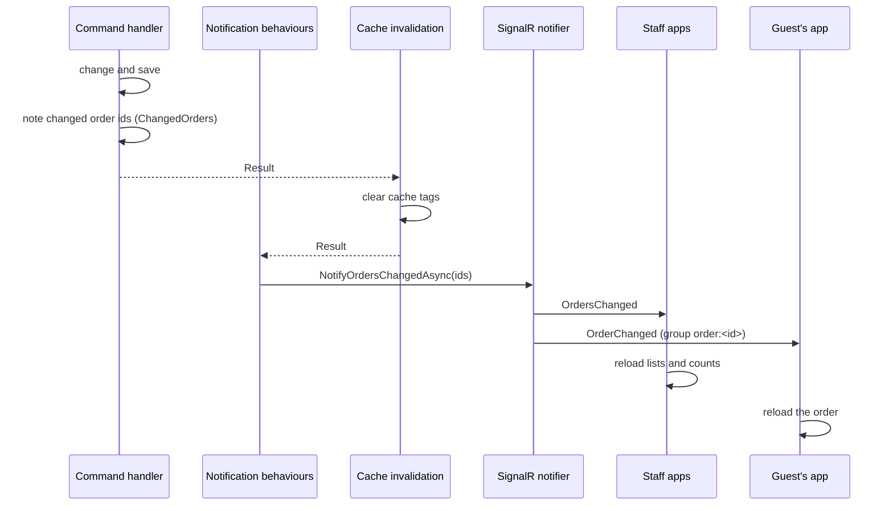

# Real-time updates

Every app shows changes as they happen: a new order appears at the bar, a guest sees their order being prepared, an item that sells out disappears from every menu. This runs on two SignalR hubs in the API.

## Hubs and messages

| Hub | Path | Who connects | Messages |
| --- | --- | --- | --- |
| **Orders hub** | `hubs/orders` | Admin web, Bar, Bartender and Register apps (Admin or Bartender token) | `OrdersChanged`, `MenuChanged`, `TablesChanged` |
| **Order tracking hub** | `hubs/order-tracking` | Customer app (anonymous) | `OrderChanged` (only for tracked orders), `MenuChanged`, `TablesChanged` |

Messages carry **no data**: they only say that something changed, and the app reloads what it shows through the normal API. That keeps the hubs simple and the data always comes through the same rules and cache.

Guests only hear about their own orders. The customer app calls the hub's single method, `TrackOrder(orderId)`, for every order it follows; the connection joins the group `order:<id>`, and `OrderChanged` goes to that group only. The order id is a random GUID returned when the order was placed, so nobody can follow an order they didn't place.

## When messages are sent

| Message | Sent after |
| --- | --- |
| `OrdersChanged` (staff) and `OrderChanged` (the guests of those orders) | Placing an order (any source), accept, start, complete, decline (bartender or admin), cancel, withdraw, pay, refund, and deactivating a bartender (which releases orders) |
| `MenuChanged` | Any change to categories or items (create, edit, status, price, category, picture, menu order, recipe, delete), and stock changes that make items sell out or come back (completing orders, waste, corrections, deliveries, closing counts) |
| `TablesChanged` | Any change to areas, tables or fixtures, and guests' calls (created or done) |

## How it is built

- **Marker interfaces** on commands decide what is sent: `IOrderNotifyingCommand`, `IMenuNotifyingCommand`, `ITablesNotifyingCommand`.
- **Pipeline behaviours** (`OrderNotificationBehavior`, `MenuNotificationBehavior`, `TablesNotificationBehavior`) call the notifiers once such a command succeeds. They sit outside the cache invalidation behaviour, so the cache is already cleared when apps reload.
- **Scoped collectors** let a handler say what it changed:
  - `ChangedOrders` holds the ids of the orders it changed, since a release can change several, known only after the handler ran.
  - `ChangedMenu` marks that stock changed whether an item can be served, so not every completed order sends a menu message.
- **Notifiers** (`SignalROrderNotifier`, `SignalRMenuNotifier`, `SignalRTablesNotifier`) are singletons in the API. If sending fails they log a warning instead of failing the request, because the change is already saved.

## In the apps

- **Staff apps** use the shared `OrdersHubService`: one connection per circuit, the user's token sent as a bearer header (server to server, so no query-string token and no CORS), automatic reconnects after 0, 2 and 10 seconds and then every 30. After a reconnect it raises all three events, because messages sent while it was down are lost.
- **The connection indicator** in the staff apps shows Live, Connecting or Offline.
- **Pages subscribe** when they initialise and unsubscribe when disposed. On a message they reload silently: no skeleton, filters, paging and selection kept, expanded rows stay open, and changed numbers roll to their new value.
- **The customer app** uses `OrderTrackingHubService` without a token, tracks every order the guest placed (again after each reconnect), and reloads its menu, cart, orders and table calls.
- **Extras in the Admin:** a snackbar for every new order on any page ("New order #128 · Table 4 · €23.50"), and new orders highlighted for 10 seconds in the orders timeline and the dashboard's recent orders.

## Timers

Some things change with time rather than events, so a few pages also re-render on a timer: relative times ("3 min ago") and waiting colours every 30 seconds in the staff apps, and the dashboard's Right now panel, which reloads every 30 seconds.