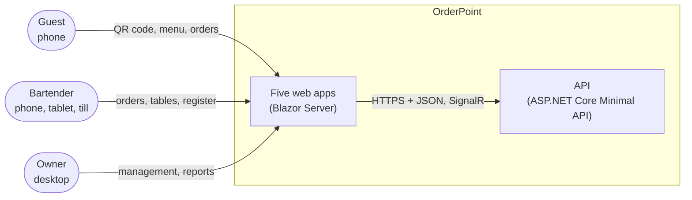
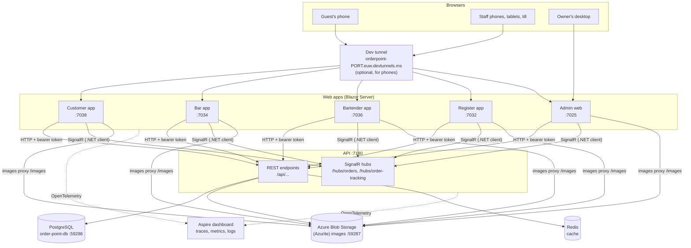

# System architecture

OrderPoint is five Blazor Server web apps and one ASP.NET Core API, backed by PostgreSQL, Azure Blob Storage and Redis, all started together by Aspire.

## Context



## Containers



## How the pieces talk

- **Browser ↔ app:** each app is Blazor Server, so the browser holds a SignalR circuit to its app and the UI runs on the app's server. The browser never calls the API itself.
- **App → API:** the app's server calls the API with typed HttpClients (Aspire service discovery resolves `order-point-api`), sending the user's JWT as a bearer token. Because every call comes from a server, the API needs no CORS.
- **API → apps (live):** the apps' servers keep a SignalR connection to the API's hubs with the .NET client and reload what they show when a message arrives. See [Real-time updates](Real-Time-Updates).
- **Images:** the API stores pictures in Blob Storage and saves their full URL. Phones can't reach the storage emulator, so every app serves images itself under `/images/...` and rewrites the stored URLs in API responses to that path.
- **Phones:** a Microsoft dev tunnel gives each app a public HTTPS address; only the apps are exposed, never the API or the data stores. See [Testing on a phone](Testing-on-a-Phone).

## Resources in Aspire

The AppHost (`app/host/OrderPoint.AppHost`) declares every resource and its dependencies:

| Resource | What it is | Port | Notes |
| --- | --- | --- | --- |
| `postgres` / `order-point-db` | PostgreSQL container and database | 59286 | Persistent container with a data volume |
| `storage` / `images` | Azure Storage emulator (Azurite), blob container `images` | 59287 | Persistent, data volume; the port is fixed because image URLs are stored with it |
| `cache` | Redis | dynamic | No volume: every run starts empty |
| `order-point-api` | The API | 7180 (https), 5171 (http) | Waits for the database, the image container and Redis |
| `order-point-admin` | Admin web | 7025 / 5130 | Waits for the API |
| `order-point-register` | Register app | 7032 / 5132 | Waits for the API |
| `order-point-bar` | Bar app | 7034 / 5134 | Waits for the API |
| `order-point-bartender` | Bartender app | 7036 / 5136 | Waits for the API |
| `order-point-customer` | Customer app | 7038 / 5138 | Waits for the API |
| `pgweb` | Browse the database | dynamic | Developer tool |
| `storage-blobs-explorer` | Browse blobs | dynamic | Developer tool |
| `redisinsight` | Browse the cache | dynamic | Developer tool |
| `tunnel` | Dev tunnel for phones | - | Started by hand from the dashboard |

The Aspire dashboard runs at `https://localhost:17092`.

Settings passed by the AppHost:
- **Business day start hour** (6): to the API and the staff apps.
- **Images storage URL:** to the apps.
- **Customer app's address:** to the Admin, for the QR codes.

## Solution layout

```
app/
  OrderPoint.slnx
  host/
    OrderPoint.AppHost            Aspire orchestration
    OrderPoint.ServiceDefaults    shared OpenTelemetry, health endpoints, service discovery, resilience
  api/
    OrderPoint.Domain             entities, rules, errors, Result type
    OrderPoint.Application        commands, queries, handlers, DTOs, repository interfaces
    OrderPoint.Infrastructure     EF Core, repositories, Identity, blob storage, payment provider
    OrderPoint.Api                Minimal API endpoints, validators, hubs, OpenAPI
  web/
    OrderPoint.Shared             Razor class library shared by the five apps
    OrderPoint.Admin
    OrderPoint.Bar
    OrderPoint.Bartender
    OrderPoint.Register
    OrderPoint.Customer
```

The API projects depend inwards: Api → Infrastructure → Application → Domain. The web apps never reference the API projects; they talk to it over HTTP and keep their own copies of the DTOs. Each app references `OrderPoint.Shared`, and the apps never reference each other.

## Where to read next

- [Backend architecture](Backend-Architecture) and [Frontend architecture](Frontend-Architecture) for the inside of each part.
- [Key flows](Key-Flows) for sequence diagrams of the main scenarios.
- [Tech stack](Tech-Stack) for versions.